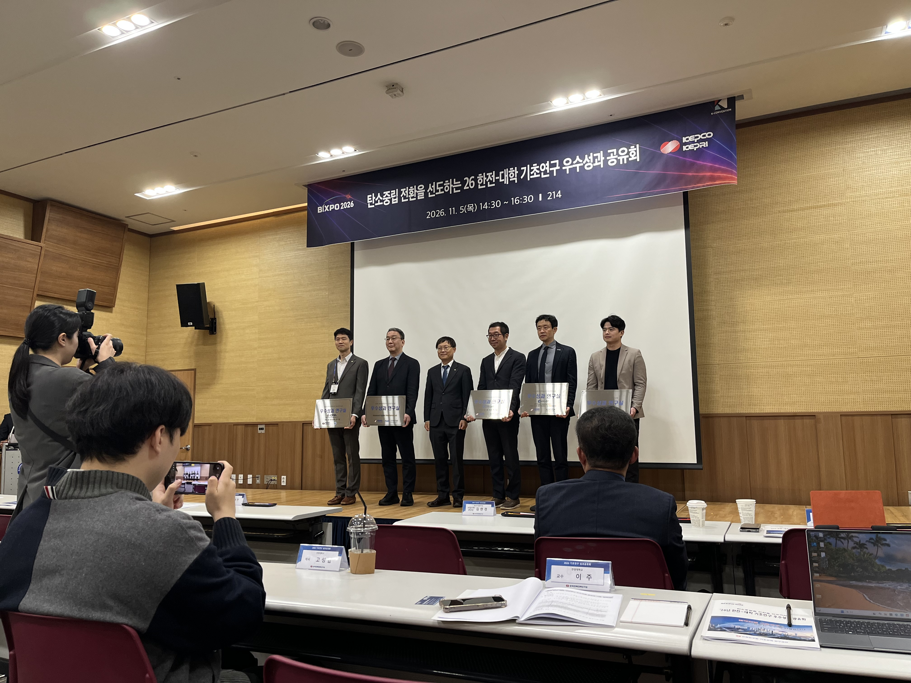
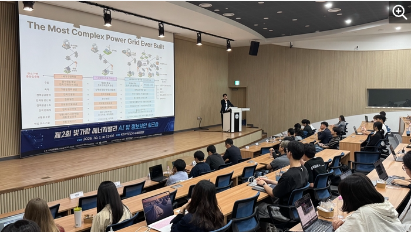
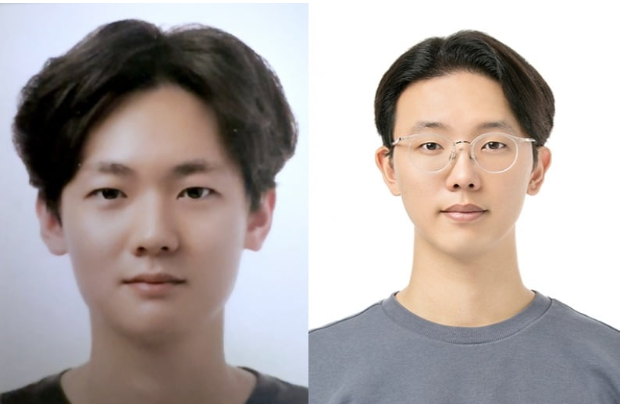
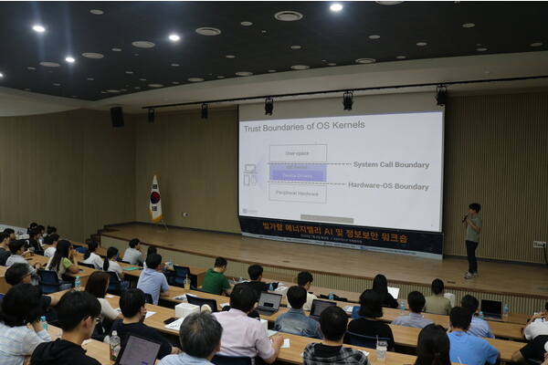

<section class="press-section">
  <h2 class="press-section-title">Press</h2>

  

    <article class="press-card">
    
  

    
Research Achievement

    <h3 class="press-title">
      KENTECH Selected for Two KEPCO Basic Research Excellence Projects
    </h3>
    
November 5, 2026 · Newsis

    

      KENTECH was selected for two projects recognized for excellence in
      KEPCO basic research. The article also reports on awards received
      by two students.
    

    

      <a href="https://mobile.newsis.com/view_amp.html?ar_id=NISX20261105_0003856835"
         target="_blank" rel="noopener noreferrer">
        Read Original Article
      </a>
    

  

</article>

    <!-- Post 1: October 2026 workshop -->
    <article class="press-card">
      

      

        
Workshop

        <h3 class="press-title">
            KENTECH Hosts Bitgaram Energy Valley AI and Information Security Workshop
        </h3>

        
October 2, 2026 · Electronic Times

        

          KENTECH hosted the second Bitgaram Energy Valley AI and
          Information Security Workshop, organized by the KENTECH
          Energy AI Research Institute and its partners. The workshop
          brought together researchers and experts to discuss
          next-generation power grid safety, AI, and emerging
          cybersecurity technologies for energy infrastructure.
        

        

          <a href="https://m.etnews.com/20261002000045"
             target="_blank" rel="noopener noreferrer">
            Read original article ↗
          </a>
        

      

    </article>

    <!-- Post 2: Energy AI research funding -->
    <article class="press-card">
      

      

        
Research Funding

        <h3 class="press-title">
                     KENTECH Selected for Major National AI Initiative
        </h3>

        
Six-year research funding · Seoul Economic Daily

        

          KENTECH's Energy AI Research Institute is undertaking
          AI research projects supported by funding totaling
          KRW 50 billion over six years. The initiative supports
          the institute's research activities in artificial intelligence.
        

        

          <a href="https://m.sedaily.com/amparticle/20097229"
             target="_blank" rel="noopener noreferrer">
            Read original article ↗
          </a>
        

      

    </article>

    <!-- Post 3: Student awards -->
    <article class="press-card">
      

      

        
Student Achievement

        <h3 class="press-title">
                      KENTECH Undergraduate Students Receive Academic Conference Awards
        </h3>

        
May 27, 2026 · Hankyung

        

          Two undergraduate students from our lab, Jang Hyun-gyu
          and Choi Tae-jun, received awards at ASK 2026 and CISC-S 2026.
          Their recognized research addressed federated malware
          detection and AI-based intrusion detection.
        

        

          <a href="https://www.hankyung.com/article/202605271704h"
             target="_blank" rel="noopener noreferrer">
            Read original article ↗
          </a>
        

      

    </article>

    <!-- Post 4: Previous year's workshop -->
    <article class="press-card">
      

      

        
Workshop

        <h3 class="press-title">
            KENTECH Envisions the Future of Energy AI and Security
        </h3>

        
2025 · Energy News

        

          Energy News covers a workshop conducted by KENTECH
          last year, addressing the future of energy AI and security.
        

        

          <a href="https://www.energy-news.co.kr/news/articleView.html?idxno=215513"
             target="_blank" rel="noopener noreferrer">
            Read original article ↗
          </a>
        

      

    </article>

  

</section>
